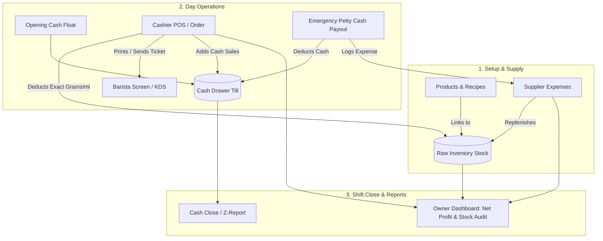

# Kahera POS — Coffee Shop Operations & Business Flow Guide

This document walks through an end-to-end operational day in a coffee shop using **Kahera POS**. It illustrates how **Menu Products**, **Inventory**, **Expenses**, **Point of Sale (POS)**, and **Reporting** work seamlessly together in real time.

---

## High-Level Operational Architecture



---

## Initial Setup Sequence: What to Add First (Creation Order)

When setting up a new store or starting from an empty database, follow this **exact creation order**. Because items have dependencies (for example, a recipe requires both a finished product and raw ingredients to exist first), creating them in this order avoids errors and backtracking:

| Step | Section in Kahera | What You Create | Why It Comes in This Order |
| :---: | :--- | :--- | :--- |
| **1** | **Products ➔ Categories** | *Coffee & Espresso*, *Cold Drinks*, *Pastries* | Products need a category to be grouped under on the POS. |
| **2** | **Inventory ➔ Supplies** | *Coffee Beans* (unit: `g`), *Fresh Milk* (unit: `ml`), *Cups & Lids* (unit: `each`) | Raw stock items must exist before you can write recipes or receive shipments. |
| **3** | **Products ➔ Add-on Groups** | *Milk Options* (Oat, Almond), *Extra Shots*, *Syrups* | Modifiers must exist before you can attach them to drinks. |
| **4** | **Products ➔ Products** | *Spanish Latte* (₱160), with Variants (12oz / 16oz) and attached Add-on Groups | Requires Category (#1) and Add-on Groups (#3). |
| **5** | **Inventory ➔ Recipes** | Link *Spanish Latte* to `18g` Beans + `200ml` Milk + `1` Cup | **Connects the system:** Requires Product (#4) and Supplies (#2). |
| **6** | **Expenses & Receive Stock** | Log supplier invoice in **Expenses**; click **Receive Stock** in **Inventory** | Stock can now be added to the supplies created in Step #2. |
| **7** | **POS (Start Day)** | Open the till with **Opening Float** (e.g. ₱2,000) and take orders | Recipes will automatically deplete stock with every sale! |

---

## Chronological Operational Flow

### Step 1: Menu & Recipe Setup (Products ➔ Inventory)

In a coffee shop, beverages are assembled from raw bulk ingredients. Kahera bridges customer-facing menu choices directly to kitchen inventory:

- **Customer-Facing Menu:**
  - **Item:** Spanish Latte (`₱160`)
  - **Sizes:** Regular (12oz) or Large (16oz)
  - **Add-ons:** Extra Espresso Shot (`+₱30`), Oat Milk Swap (`+₱40`)
- **Behind-the-Scenes Recipe (BOM / Bill of Materials):**
  - **1 Regular Spanish Latte** links to:
    - `18g` Coffee Beans
    - `200ml` Fresh Milk
    - `1` Paper Cup & Lid
  - **Add-on rules:** Selecting *"Extra Shot"* automatically attaches an extra `18g` of coffee beans to the order consumption.
- **Why this matters:** Cashiers don't need to know stock formulas. They tap buttons on screen, and Kahera calculates ingredient deductions accurately behind the scenes.

---

### Step 2: Buying Ingredients (Expenses ➔ Inventory)

Before opening or during weekly replenishment, the owner buys raw supplies from suppliers:

- **The Purchase:**
  - `10 kg` Coffee Beans (`₱6,000`)
  - `20 Liters` Fresh Milk (`₱1,800`)
- **Logged in Expenses:**
  - The owner opens the **Expenses** screen and creates an entry categorized under *"Raw Ingredients & Dairy"*.
  - Attaches the supplier invoice/receipt reference and specifies the payment method (e.g., Bank Transfer, GCash, or Company Cash).
- **Inventory Stock Automatically Updated:**
  - Beans inventory automatically increases by `+10,000g`.
  - Milk inventory automatically increases by `+20,000ml`.
- **Why this matters:** Eliminates double-entry. The business maintains a timestamped audit trail connecting money spent directly to on-hand kitchen stock.

---

### Step 3: Cashier Opens the Register (Cash Drawer Float)

At 7:00 AM, the opening cashier starts their shift:

- **The Opening Float:**
  - The cashier is handed `₱2,000` in change (coins and small bills) to begin operations.
  - In Kahera POS, they enter `₱2,000` as the **Opening Float**.
- **Audit Lock:**
  - Kahera anchors this initial starting cash balance for the shift.
  - All subsequent cash transactions (sales, payouts, change) are tracked against this verified baseline.

---

### Step 4: Customer Orders Coffee (POS ➔ Orders ➔ Kitchen / Barista)

During peak morning rush, a customer walks in to order:

1. **Ordering at the POS:**
   - Cashier taps: **1 Large Iced Spanish Latte** + **Oat Milk Swap**.
   - Selects Order Type: **Takeaway**.
   - Payment Tendered: Customer hands `₱500` cash (or scans via GCash / Card).
   - The screen shows the exact change due (`₱300`).
2. **Instant Barista Notification:**
   - **Paperless Mode:** The order appears instantly on the **Barista Screen (KDS)**:
     ```text
     Order #042 [Takeaway]
     1x Large Iced Spanish Latte
        └─ Oat Milk Swap
     ```
   - **Thermal Printer Mode (Optional):** A kitchen order ticket (KOT) prints at the espresso bar.
3. **Automatic Real-Time Stock Depletion:**
   - Without manual intervention, Kahera updates raw inventory in real time:
     - `24g` Coffee Beans
     - `250ml` Oat Milk
     - `1` Cold Cup, Straw & Dome Lid
- **Why this matters:** Baristas focus on crafting drinks while stock levels stay 100% accurate to the single gram or milliliter.

---

### Step 5: Emergency Petty Cash (Till Payout ➔ Expenses)

At 2:00 PM, the coffee shop runs low on bagged tube ice:

- **The Action:**
  - The barista takes `₱200` directly from the cash drawer to buy 4 bags of ice from the convenience store next door.
- **Recording in Kahera POS:**
  - Cashier taps **Cash Movement ➔ Pay-Out (Expense)**.
  - Types the reason: *"Emergency Tube Ice Bags"* and amount `₱200`.
- **System Impact:**
  - The `₱200` is immediately registered as an operating expense.
  - The cash drawer expected balance is updated so the till is not marked short at closing time.

---

### Step 6: End of Day Reconciliation (Day-Close & Z-Report)

At 9:00 PM, the shop closes for the evening:

#### 1. Cash Drawer Count (Z-Report)
The cashier triggers the **Cash Close / Z-Report** workflow:

$$\begin{aligned}
\text{Opening Float} &\quad \text{₱2,000} \\
+\;\text{Cash Sales} &\quad \text{₱14,500} \\
-\;\text{Ice Payout} &\quad \text{₱200} \\
\hline
=\;\mathbf{\text{Expected Cash in Drawer}} &\quad \mathbf{\text{₱16,300}}
\end{aligned}$$

The cashier counts the physical cash in the till:
- Physical Cash Count: `₱16,300`
- Variance: **`₱0.00`** (Perfect balance)

#### 2. Owner's Daily Business Health Report
The owner opens the **Dashboard** and gets a complete, unified summary of the day:

| Metric | Daily Summary |
| :--- | :--- |
| **Gross Revenue** | `₱21,400` *(135 cups sold across Cash & GCash)* |
| **Stock Used** | Exact grams of beans, liters of milk, and cups consumed |
| **Operating Expenses** | Supplier raw restock (`₱7,800`) + Emergency Ice (`₱200`) |
| **Net Daily Profit** | Gross Sales minus Cost of Goods Sold (COGS) & Expenses |

---

## Key Benefits for the Coffee Shop Owner

1. **Anti-Theft & Till Accountability:** Every peso in the drawer is tied to an opening float, verified order, or logged petty cash payout.
2. **Waste & Shrinkage Visibility:** If 100 cups of milk drinks were sold but 30 liters of milk are missing instead of 20, the owner can easily spot spillage or theft.
3. **Hardware Flexibility:** Operates completely paperless (via interactive Barista KDS) or with standard 80mm/58mm ESC/POS thermal printers.
4. **100% Offline-First:** Internet outages never halt ordering, cash register operations, or kitchen dispatch.
